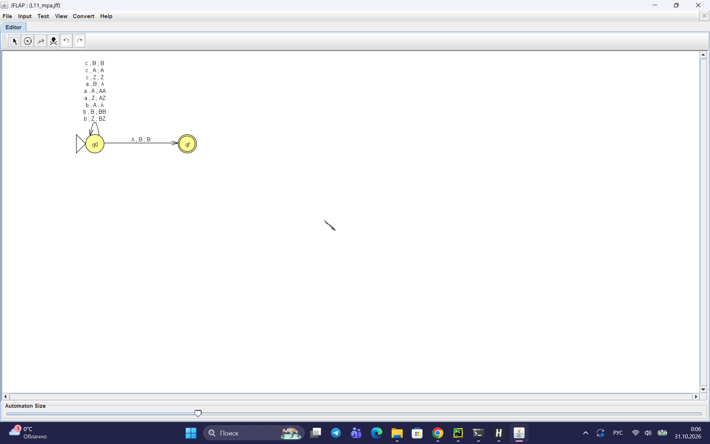
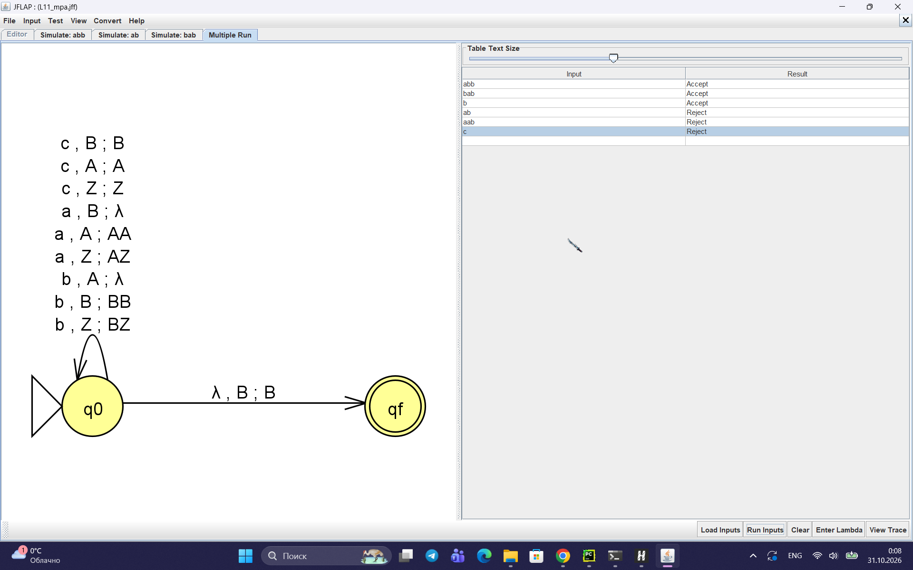
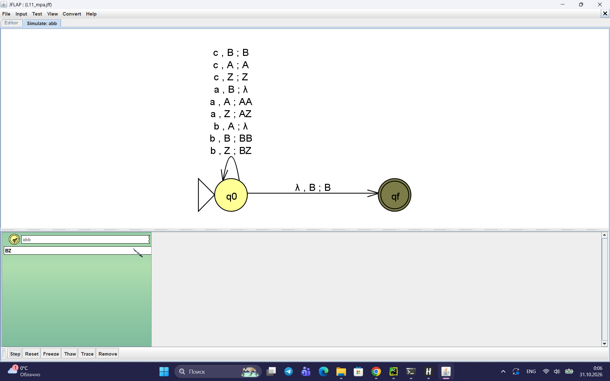
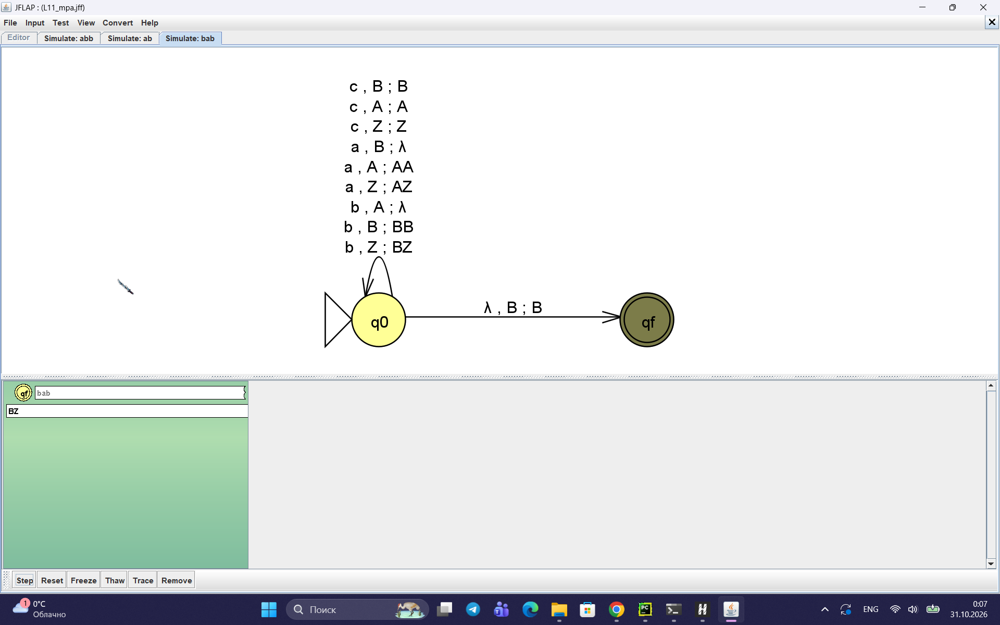
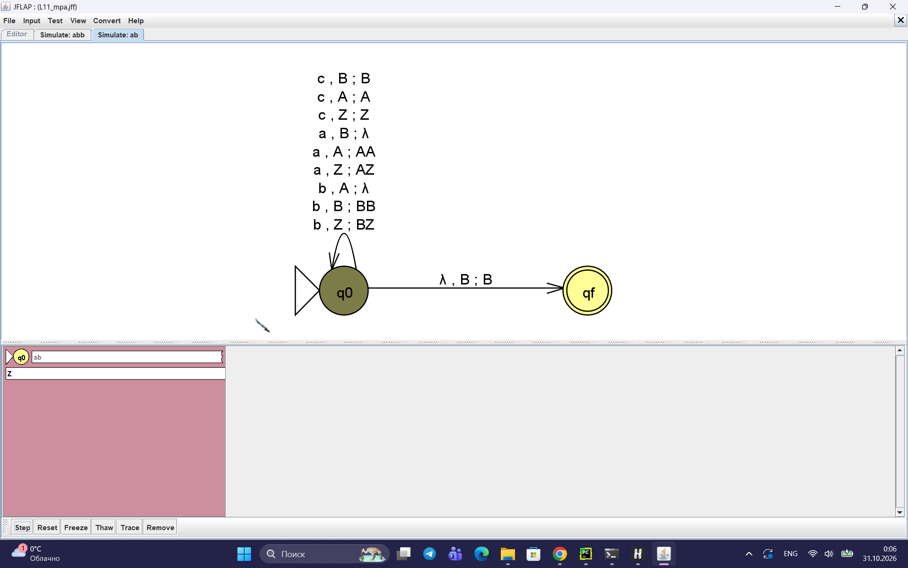
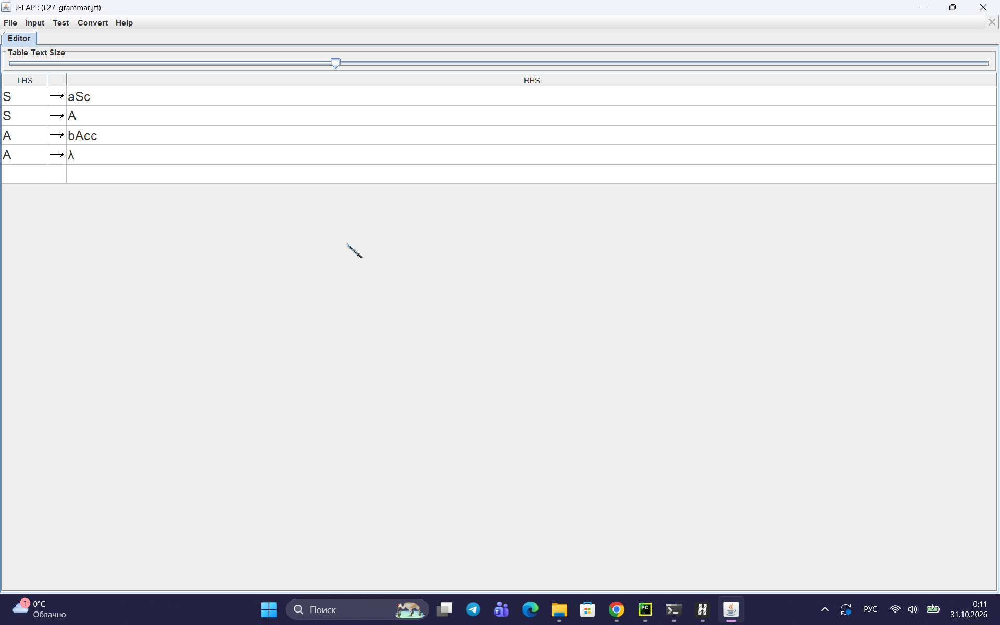
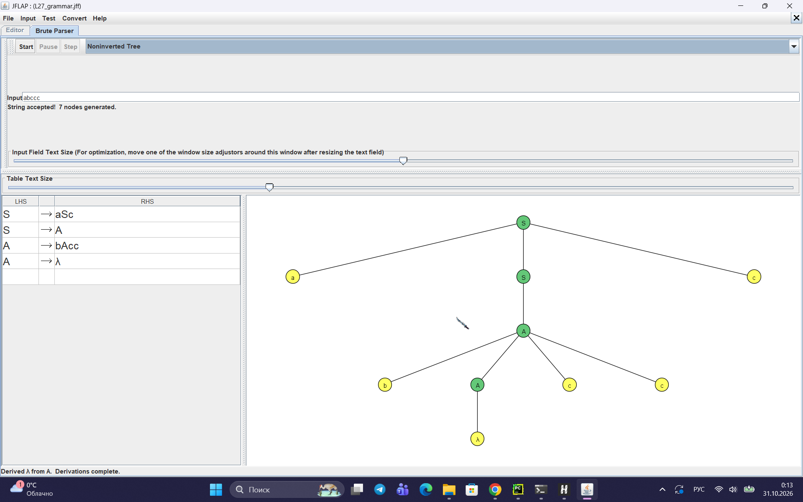
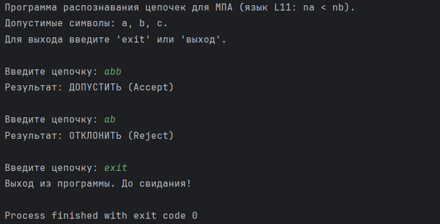

Министерство науки и высшего образования РФ

Федеральное государственное автономное образовательное учреждение высшего образования

**«СИБИРСКИЙ ФЕДЕРАЛЬНЫЙ УНИВЕРСИТЕТ»**

Институт космических и информационных технологий
Кафедра программной инженерии

---

# ОТЧЁТ №3

### по практической работе на тему «Автоматы с магазинной памятью, контекстно-свободные грамматики и языки»

_(Теория автоматов, языков и вычислений)_

---

Преподаватель: Мымликов В.Н.

Студент: Шишко Д.Д., гр. КИ24-16/1Б

Красноярск 2026

<!-- pagebreak -->

## 1 Цель работы и постановка задачи

**Цель работы:**

1. Исследовать автоматы с магазинной памятью (МПА) и контекстно-свободные грамматики (КСГ).
2. Изучить свойства контекстно-свободных языков (КСЯ).
3. Освоить методы доказательства принадлежности языков к классу КСЯ.
4. Реализовать МПА программно.

**Постановка задачи (Вариант 11):**

1. **Часть 1.** Построить в JFLAP МПА для языка `L11 = {w : na(w) < nb(w)}` (алфавит `{a, b, c}`), либо доказать невозможность.
2. **Часть 2.** Построить в JFLAP КСГ для языка `L27 = {a^n b^m c^k : k = n + 2m, m ≥ 0, n ≥ 0, k ≥ 0}`.
3. **Часть 3.** Формально доказать принадлежность языка `L43 = {a^{n+2} : n ≥ 0}` классу КСЯ.
4. **Дополнительное задание.** Написать программную реализацию МПА на Python.

---

## 2 Часть 1. Автомат с магазинной памятью для L11

**Язык:** `L11 = {w : na(w) < nb(w)}`.
В этом языке символы `a` и `b` могут идти в произвольном порядке (например, `abb`, `bab`, `bbac`), а символ `c` просто игнорируется и не влияет на условие.

### 2.1 Идея построения и формальное обоснование МПА

Для распознавания этого языка МПА должен «считать» разность между количеством `b` и `a`. Так как порядок символов произвольный, магазин будет хранить не сами буквы в порядке их поступления, а **знак и величину разности** `nb(w) - na(w)`.

- Если в прочитанном префиксе больше `b`, в магазине накапливаются символы `B`.
- Если больше `a`, в магазине накапливаются символы `A`.
- При чтении символа, который уменьшает текущую разность (например, `a`, когда в стеке `B`), верхний символ стека выталкивается (они «съедают» друг друга).
- Если стек пуст (на дне `Z`), чтение символа начинает накапливать разность нового знака, помещая соответствующий символ (`A` или `B`) в стек.

**Критерий принятия:** по **финальному состоянию**. Автомат переходит в финальное состояние `qf` только тогда, когда вся строка прочитана, и на вершине магазина находится `B` (то есть `nb > na`).

**Формальное доказательство корректности (инвариант):**
Пусть после прочтения любого префикса `u` (где `u` — начало входной строки `w`) содержимое стека описывается следующими правилами:

- Если `d = nb(u) − na(u) > 0`, то стек имеет вид `B^d Z` (содержит `d` символов `B` и дно `Z`).
- Если `d < 0`, то стек имеет вид `A^{-d} Z` (содержит `-d` символов `A` и дно `Z`).
- Если `d = 0`, то стек содержит только `Z`.

_Доказательство по индукции:_

1. **База:** для пустого префикса (длина 0) `d = 0`, стек равен `Z` — соответствует инварианту.
2. **Переход:** предположим, инвариант верен для префикса длины `k`. Рассмотрим шаг с символом `x`.
   - Если читаем `b` (увеличивает `d` на 1): если стек был `B^d Z`, станет `B^{d+1} Z` (соответствует). Если был `A^{-d} Z` (где `-d > 0`), верхний `A` выталкивается (съедается), что соответствует `d+1`. Если был `Z`, кладем `B`, получаем `BZ` — соответствует.
   - Если читаем `a` (уменьшает `d` на 1): аналогично, либо добавляется `A`, либо съедается `B`.
   - Если читаем `c`: стек не меняется, `d` не меняется.
3. Следовательно, инвариант выполняется на каждом шаге.
4. **Принятие:** автомат переходит в финальное состояние `qf` только при наличии `B` на вершине после прочтения всей строки `w`. Это значит `d = nb(w) − na(w) > 0`, что в точности совпадает с условием языка `nb(w) > na(w)`. Если строка заканчивается при пустом стеке или с `A` на вершине, перехода в `qf` нет, и строка отклоняется.

### 2.2 Граф переходов и проверка

Граф переходов полученного МПА в JFLAP приведён на рисунке 1.

Рисунок 1 — Граф переходов МПА (критерий принятия — по финальному состоянию)

Результаты проверки цепочек в режиме Multiple Run приведены на рисунке 2. Видно, что строки `abb`, `bab` и `b` принимаются, а `ab`, `aab` и `c` — отклоняются.

Рисунок 2 — Результаты проверки тестовых цепочек

**Пошаговый разбор работы автомата:**

- Цепочка `abb`. Читаем `a` (в стеке `A`), затем `b` (съедает `A`, стек пуст), затем `b` (стек `B`). Строка кончилась, в стеке `B`. Автомат переходит в `qf`. Цепочка допускается (рисунок 3).
- Цепочка `bab`. Читаем `b` (в стеке `B`), затем `a` (съедает `B`, стек пуст), затем `b` (стек `B`). Строка кончилась, в стеке `B`. Допускается (рисунок 4). Это доказывает, что порядок символов не важен.
- Цепочка `ab`. Читаем `a` (стек `A`), затем `b` (съедает `A`, стек пуст). Строка кончилась, в стеке только дно `Z`. Перехода в `qf` нет, цепочка отклоняется (рисунок 5).

Рисунок 3 — Допуск цепочки `abb`

Рисунок 4 — Допуск цепочки `bab`

Рисунок 5 — Отклонение цепочки `ab`

---

## 3 Часть 2. Контекстно-свободная грамматика для L27

**Язык:** `L27 = {a^n b^m c^k : k = n + 2m}`.
Условие означает, что на каждую букву `a` должна приходиться одна буква `c` в конце, а на каждую букву `b` — две буквы `c`.

### 3.1 Построение грамматики

Для генерации такого языка достаточно следующих правил:

S -> aSc | A
A -> bAcc | ε

Логика работы правил:

- `S -> aSc` генерирует по одной букве `a` в начале и одной `c` в конце.
- `S -> A` означает переход к генерации блока с буквами `b`.
- `A -> bAcc` генерирует одну `b` и сразу две `c` в конце.
- `A -> ε` завершает вывод строки.

### 3.2 Проверка грамматики в JFLAP

Правила грамматики в окне редактора JFLAP приведены на рисунке 6.

Рисунок 6 — Правила КСГ для языка L27

Дерево разбора для строки `abccc` (где n=1, m=1, k=1+2=3) приведено на рисунке 7. Оно наглядно подтверждает, что грамматика корректно выводит строки языка.

Рисунок 7 — Дерево разбора для цепочки `abccc`

---

## 4 Часть 3. Доказательство принадлежности классу КСЯ

**Язык:** `L43 = {a^{n+2} : n ≥ 0}`.

**Утверждение:** Язык `L43` принадлежит классу контекстно-свободных языков.

**Доказательство:**

1. Проанализируем язык `L43`. При n=0 строка равна `aa`. При n=1 — `aaa` и т.д. Таким образом, язык представляет собой множество всех строк, состоящих только из букв `a`, длина которых больше либо равна 2.
2. Данный язык можно легко задать регулярным выражением `aaa*` (две обязательные буквы `a` и любое количество `a` после них).
3. Так как язык задается регулярным выражением, он является **регулярным**.
4. Из теории автоматов известно, что класс регулярных языков является подмножеством класса контекстно-свободных языков (РЯ ⊂ КСЯ).
5. Следовательно, язык `L43` является **контекстно-свободным**.

_(Дополнительно: для данного языка можно легко построить КСГ, например: `S -> aaA`, `A -> aA | ε`, и ДКА: `q0 -a-> q1 -a-> q2`, где `q2` финальное с петлей по `a`)._

---

## 5 Дополнительное задание. Программная реализация МПА

Реализован программный МПА на языке Python для распознавания языка `L11`. Код строго соответствует формальному определению МПА `P = (Q, Σ, Γ, δ, q0, Z0, F)`.
**Критерий принятия:** по финальному состоянию (`F = {qf}`).

Скриншот работы программы приведён на рисунке 8.

Рисунок 8 — Проверка цепочек программной реализацией МПА

**Исходный код программы (`mpa.py`):**

    Q = {'q0', 'qf'}
    Sigma = {'a', 'b', 'c'}
    Gamma = {'Z', 'A', 'B'}
    q0 = 'q0'
    Z0 = 'Z'
    F = {'qf'}

    delta = {
        ('q0', 'b', 'Z'): ('q0', 'BZ'),
        ('q0', 'b', 'B'): ('q0', 'BB'),
        ('q0', 'b', 'A'): ('q0', ''),
        ('q0', 'a', 'Z'): ('q0', 'AZ'),
        ('q0', 'a', 'A'): ('q0', 'AA'),
        ('q0', 'a', 'B'): ('q0', ''),
        ('q0', 'c', 'Z'): ('q0', 'Z'),
        ('q0', 'c', 'A'): ('q0', 'A'),
        ('q0', 'c', 'B'): ('q0', 'B'),
        ('q0', '', 'B'):  ('qf', 'B')
    }

    def mpa_accepts(word):
        state = q0
        stack = [Z0]

        for ch in word:
            top = stack[-1]

            if (state, ch, top) in delta:
                new_state, push_str = delta[(state, ch, top)]

                stack.pop()
                if push_str != '':
                    for symbol in reversed(push_str):
                        stack.append(symbol)

                state = new_state
            else:
                return False

        if (state, '', stack[-1]) in delta:
            new_state, push_str = delta[(state, '', stack[-1])]
            state = new_state

        return state in F

    def main():
        print("Программа распознавания цепочек для МПА (язык L11: na < nb).")
        print("Допустимые символы: a, b, c.")
        print("Для выхода введите 'exit' или 'выход'.\n")

        while True:
            user_input = input("Введите цепочку: ").strip()

            if user_input.lower() in ['exit', 'выход']:
                print("Выход из программы. До свидания!")
                break

            is_valid = True
            for char in user_input:
                if char not in Sigma:
                    is_valid = False
                    break

            if not is_valid:
                print(f"Ошибка! В цепочке есть символы, которых нет в алфавите {Sigma}.")
                print("Попробуйте еще раз.\n")
                continue

            word = list(user_input)
            res = mpa_accepts(word)
            result = "ДОПУСТИТЬ (Accept)" if res else "ОТКЛОНИТЬ (Reject)"

            print(f"Результат: {result}\n")

    if __name__ == "__main__":
        main()

---

## 6 Заключение

В ходе выполнения практической работы были детально изучены автоматы с магазинной памятью и контекстно-свободные грамматики.
Был разработан МПА для языка `L11`, учитывающий произвольный порядок символов за счет хранения знака разности в стеке. Приведено формальное доказательство корректности на основе инварианта стека. Для языка `L27` составлена КСГ и проверено её дерево разбора. С использованием теории формальных языков доказана контекстно-свободность языка `L43`. Также реализован дополнительный программный МПА на Python, который корректно эмулирует работу магазина и логику переходов.
